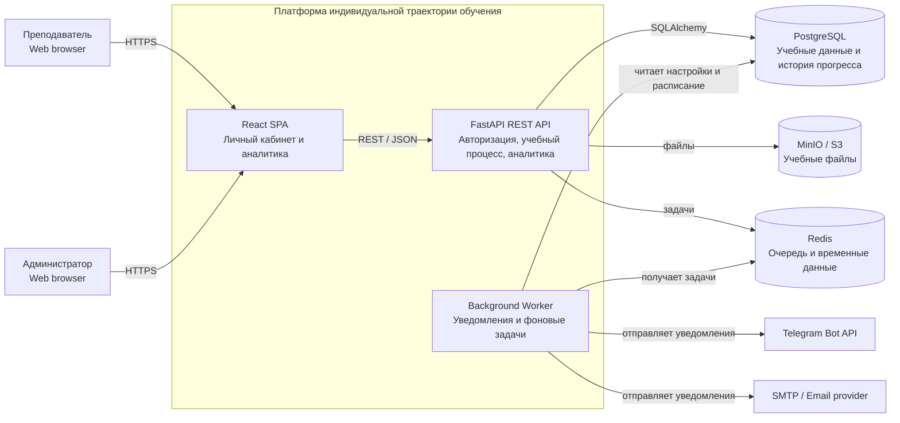
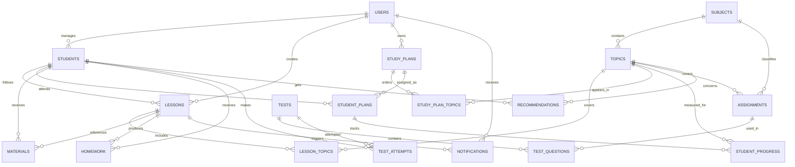

# Архитектура платформы индивидуальной траектории обучения

## 1. Назначение системы

Платформа предназначена для преподавателей и репетиторов, которые ведут индивидуальное обучение. Система хранит данные учащихся, планирует занятия, связывает занятия с темами учебного плана, принимает результаты заданий и тестов, показывает динамику прогресса и предлагает следующие шаги обучения.

Первая версия является teacher-first системой: преподаватель работает в личном кабинете, а администратор управляет общими объектами платформы. Доступ учащегося к отдельному кабинету может быть добавлен позднее.

## 2. Роли и границы доступа

### Преподаватель

Преподаватель может:

- управлять собственным профилем;
- создавать, редактировать и архивировать учащихся;
- просматривать историю обучения только связанных с ним учащихся;
- создавать и переносить занятия;
- фиксировать проведённые занятия и изученные темы;
- выбирать или создавать учебные планы;
- адаптировать план под учащегося;
- загружать учебные материалы;
- выдавать домашние задания;
- назначать тесты;
- просматривать результаты и аналитику;
- принимать, отклонять и изменять рекомендации системы.

### Администратор

Администратор может:

- управлять пользователями и ролями;
- блокировать пользователей;
- управлять предметами и темами;
- управлять базой заданий;
- модерировать общие учебные планы;
- просматривать системную статистику;
- просматривать технические журналы в пределах предоставленных прав.

## 3. Основные Use Cases

### UC-01 Создание учащегося

**Актор:** Преподаватель.

**Предусловие:** преподаватель авторизован.

**Основной сценарий:**

1. Преподаватель открывает раздел учащихся.
2. Заполняет ФИО, контакты, класс или курс и учебную информацию.
3. Система проверяет обязательные поля.
4. Система создаёт карточку и связывает её с преподавателем.
5. Карточка становится доступна в расписании и учебном процессе.

**Результат:** создана карточка учащегося с владельцем-преподавателем.

### UC-02 Планирование занятия

**Актор:** Преподаватель.

**Предусловие:** существуют учащийся и предмет.

**Основной сценарий:**

1. Преподаватель выбирает учащегося и предмет.
2. Указывает дату, время и длительность.
3. Система проверяет пересечения расписания.
4. Преподаватель подтверждает занятие.
5. Система сохраняет занятие и создаёт запланированные уведомления.

**Альтернативный сценарий:** при конфликте времени система показывает пересекающиеся занятия и не сохраняет запись до исправления времени.

### UC-03 Фиксация проведённого занятия

**Актор:** Преподаватель.

**Основной сценарий:**

1. Преподаватель открывает запланированное занятие.
2. Устанавливает статус «проведено».
3. Выбирает изученные темы.
4. Добавляет выполненные задания, результат, домашнюю работу и комментарий.
5. Система обновляет историю учащегося.
6. Система пересчитывает показатели прогресса и проверяет правила рекомендаций.

### UC-04 Формирование рекомендации

**Актор:** Преподаватель, система.

**Основной сценарий:**

1. Система анализирует результаты учащегося.
2. Сравнивает показатели с порогами правил.
3. Создаёт рекомендацию с указанием причины.
4. Преподаватель принимает, отклоняет или редактирует рекомендацию.
5. При принятии система обновляет индивидуальную траекторию.

### UC-05 Управление базой заданий

**Актор:** Администратор.

**Основной сценарий:**

1. Администратор открывает базу заданий.
2. Создаёт или редактирует задание.
3. Указывает предмет, тему, тип, сложность и правильный ответ.
4. Система валидирует данные.
5. Задание становится доступно для составления тестов и вариантов.

### UC-06 Модерация общего учебного плана

**Актор:** Администратор.

**Основной сценарий:**

1. Администратор открывает список планов, ожидающих модерации.
2. Проверяет предмет, темы, порядок и контрольные точки.
3. Публикует план или возвращает его автору с замечанием.
4. Опубликованный план доступен преподавателям для копирования в свою библиотеку.

## 4. Архитектурный стиль

Для первой версии выбран модульный монолит с асинхронным worker-процессом.

Такой подход соответствует объёму проекта:

- бизнес-правила остаются в одном backend-приложении;
- модули можно развивать независимо внутри единого кода;
- PostgreSQL обеспечивает транзакционность учебной истории;
- worker выносит уведомления и другие долгие задачи из HTTP-запросов;
- при росте нагрузки отдельные модули можно выделить в сервисы позднее.

## 5. C4 Container

Диаграмма хранится в исходном виде в [docs/c4-container.mmd](docs/c4-container.mmd).

### Контейнеры

| Контейнер | Ответственность |
|---|---|
| React SPA | Экраны личного кабинета, календарь, формы, графики и клиентская валидация |
| FastAPI REST API | Авторизация, права доступа, бизнес-правила, CRUD, аналитика и формирование рекомендаций |
| Background Worker | Отложенная отправка уведомлений, повторные попытки и плановые задачи |
| PostgreSQL | Пользователи, учащиеся, занятия, планы, задания, результаты и история прогресса |
| Redis | Очередь фоновых задач и временные данные |
| MinIO / S3 | Учебные материалы и файлы домашних заданий |
| Telegram Bot API | Уведомления в Telegram |
| SMTP-провайдер | Уведомления по электронной почте |

## 6. Данные и ERD

Исходник ER-диаграммы находится в [docs/erd.mmd](docs/erd.mmd).

Полная ERD с полями и ключами находится в исходном `.mmd` файле.

### Ключевые сущности

- `users` — учётные записи и роли;
- `students` — учащиеся, закреплённые за преподавателем;
- `subjects` и `topics` — предметы и иерархия тем;
- `lessons` и `lesson_topics` — занятия и изученные темы;
- `study_plans`, `study_plan_topics` — учебные планы и порядок тем;
- `student_plans` — назначение плана конкретному учащемуся;
- `student_progress` — прогресс по темам;
- `materials` — метаданные файлов в объектном хранилище;
- `homework` — домашние задания;
- `assignments` — база заданий;
- `tests`, `test_questions`, `test_attempts` — тесты и попытки прохождения;
- `recommendations` — объяснимые рекомендации по правилам;
- `notifications` — состояние и история уведомлений.

### Обоснование 3NF

Схема разделяет независимые факты:

- предметы и темы вынесены в отдельные таблицы;
- связи многие-ко-многим представлены таблицами `lesson_topics`, `study_plan_topics` и `test_questions`;
- назначение учебного плана учащемуся хранится отдельно от шаблона плана;
- прогресс хранится отдельно от занятия и результата теста;
- файл хранится в объектном хранилище, а в базе находятся только его метаданные;
- уведомления не дублируют данные занятия, а ссылаются на него через внешний ключ.

Каждая таблица описывает один тип объекта или одну связь. Повторяющиеся группы и составные списки не хранятся в полях строк, а выносятся в связанные записи. Для внешних ключей и часто используемых фильтров предусматриваются индексы. Уникальные ограничения нужны для email пользователя, названий предметов и других бизнес-идентификаторов.

## 7. Основные ограничения базы данных

- `users.email` — `UNIQUE`, хранится в нормализованном виде;
- `students.teacher_id` — обязательный внешний ключ;
- `topics.subject_id` — обязательный внешний ключ;
- `lesson_topics` — составной первичный ключ `(lesson_id, topic_id)`;
- `study_plan_topics` — составной первичный ключ `(study_plan_id, topic_id)`;
- `test_questions` — составной первичный ключ `(test_id, assignment_id)`;
- процентные показатели находятся в диапазоне от 0 до 100;
- длительность занятия и количество баллов должны быть положительными;
- дата окончания попытки теста не может быть раньше даты начала;
- преподаватель получает доступ только к учащимся, связанным с его `users.id`;
- архивирование учащегося не удаляет связанную историю.

## 8. Внешние интерфейсы

### REST API

Frontend обращается к backend через JSON REST API. Для защищённых запросов используется JWT. API должно проверять роль пользователя и принадлежность объекта преподавателю.

Основные группы ресурсов:

- `/api/v1/auth`;
- `/api/v1/users`;
- `/api/v1/students`;
- `/api/v1/subjects`;
- `/api/v1/topics`;
- `/api/v1/lessons`;
- `/api/v1/study-plans`;
- `/api/v1/materials`;
- `/api/v1/homework`;
- `/api/v1/assignments`;
- `/api/v1/tests`;
- `/api/v1/students/{id}/analytics`;
- `/api/v1/recommendations`.

### Файловое хранилище

Backend выдаёт временные ссылки на загрузку и скачивание, а в PostgreSQL сохраняются имя, тип, размер, ключ объекта, автор и связи с учебным процессом.

### Уведомления

API создаёт задачу в Redis, worker обрабатывает её и записывает результат в `notifications`. Для повторной отправки используется идемпотентный идентификатор события.

## 9. Нефункциональные требования

- все внешние соединения работают по HTTPS;
- пароли хранятся только в виде стойкого хэша;
- секреты не хранятся в Git;
- загрузка файлов ограничивается размером и разрешённым типом;
- операции с персональными данными записываются в журнал;
- база данных резервируется;
- ошибки API возвращаются в едином формате;
- фоновые задачи имеют статус, журнал ошибок и повторные попытки;
- API поддерживает пагинацию и фильтрацию списков;
- диаграммы и формулы аналитики должны соответствовать фактической реализации.

## 10. Результат лабораторной работы

Результаты лабораторной работы представлены в виде:

- `README.md`;
- `ARCHITECTURE.md`;
- `docs/c4-container.mmd`;
- `docs/erd.mmd`.

Эти файлы можно использовать как архитектурную основу для дальнейшей реализации backend, frontend, базы данных и фоновых задач.

## 11. REST API Specs — лабораторная работа №2

Источник контракта: [openapi.yaml](openapi.yaml), стандарт OpenAPI 3.0.3.
В лабораторной №2 создан проект интерфейса. 

### Таблица эндпоинтов

| Метод | URI | Описание | Доступ | Успех |
|---|---|---|---|---|
| GET | `/api/v1/health` | Liveness процесса, реализовано в ЛР3 | Все | 200 |
| POST | `/api/v1/auth/register` | Регистрация преподавателя | Все | 201 |
| POST | `/api/v1/auth/login` | Вход и получение JWT | Все | 200 |
| GET | `/api/v1/users/me` | Текущий пользователь | teacher, admin | 200 |
| GET | `/api/v1/students` | Список учащихся | teacher | 200 |
| POST | `/api/v1/students` | Создать учащегося | teacher | 201 |
| GET | `/api/v1/students/{id}` | Получить учащегося | teacher | 200 |
| PUT | `/api/v1/students/{id}` | Полностью обновить карточку учащегося | teacher | 200 |
| PATCH | `/api/v1/students/{id}` | Частично обновить карточку учащегося | teacher | 200 |
| DELETE | `/api/v1/students/{id}` | Удалить учащегося | teacher | 204 |
| GET | `/api/v1/lessons` | Список занятий | teacher | 200 |
| POST | `/api/v1/lessons` | Создать занятие | teacher | 201 |
| GET | `/api/v1/lessons/{id}` | Получить занятие | teacher | 200 |
| PUT | `/api/v1/lessons/{id}` | Полностью обновить занятие | teacher | 200 |
| PATCH | `/api/v1/lessons/{id}` | Частично обновить занятие | teacher | 200 |
| DELETE | `/api/v1/lessons/{id}` | Удалить занятие | teacher | 204 |
| GET | `/api/v1/subjects` | Список предметов | teacher, admin | 200 |
| POST | `/api/v1/subjects` | Создать предмет | admin | 201 |
| GET | `/api/v1/subjects/{id}` | Получить предмет | teacher, admin | 200 |
| PUT | `/api/v1/subjects/{id}` | Полностью обновить предмет | admin | 200 |
| PATCH | `/api/v1/subjects/{id}` | Частично обновить предмет | admin | 200 |
| DELETE | `/api/v1/subjects/{id}` | Удалить предмет | admin | 204 |

### Правила контракта

- Авторизация: `Authorization: Bearer <JWT>`. Регистрация, вход и health-check публичны; остальные операции защищены.
- Преподаватель видит только собственных учащихся и занятия. Чужой UUID возвращает 404, чтобы не раскрывать существование записи. 403 означает запрещённую роль или заблокированную учётную запись. Администратор управляет общими предметами; глобальный доступ к учебной истории ему не предоставляется автоматически.
- Регистрация создаёт только teacher; teacher_id извлекается из JWT, а не из тела запроса. Пароли и хэши отсутствуют в ответах.
- GET коллекций поддерживает limit (1–100, по умолчанию 20) и offset (от 0). Ответ содержит items, total, limit, offset; total считается после фильтрации и до пагинации.
- PUT требует все изменяемые поля, PATCH — хотя бы одно. Неизвестные поля запрещены. null разрешён только для явно nullable-полей.
- Для учащихся предпочтительно архивирование через PATCH. DELETE используется только без зависимостей и возвращает 204 без тела. Повторный DELETE может вернуть 404: это не нарушает идемпотентность.
- Даты занятий передаются в RFC 3339 со смещением часового пояса; хранятся как UTC. Пересечения неотменённых занятий преподавателя дают 409. Смежные интервалы разрешены.
- Перенос меняет starts_at. Статусы занятий: scheduled, completed, cancelled, missed. Терминальные статусы не изменяются; повтор текущего статуса разрешён.
- Все ошибки используют ErrorResponse: code, message, timestamp и необязательный список details. Коды: 400, 401, 403, 404, 409, 500. Для будущей реализации на FastAPI ошибки валидации 422 необходимо преобразовать в 400 согласно контракту.
- 201 возвращает созданный объект и Location (для основных ресурсов). 204 не содержит JSON.
- Полный API остальных модулей (планы, тесты, материалы, рекомендации) будет добавлен позднее; этот контракт покрывает ключевые ресурсы первой версии.

### Просмотр и проверка

Инструкция Swagger UI и ответы для защиты: [docs/LAB2.md](docs/LAB2.md).

## 12. Каркас backend — лабораторная работа №3

Реализован публичный GET /api/v1/health с полями status, app_name, version, environment, uptime_seconds. Подробности и запуск: [docs/LAB3.md](docs/LAB3.md).

Слои: api → services → domain. Адаптер infrastructure реализует интерфейс Clock; зависимости собираются в backend/app/main.py. Сервис не зависит от FastAPI и настроек окружения. repositories выделен для следующих этапов, обращения к базе пока отсутствуют.

Настройки читает Pydantic Settings из окружения и корневого .env. В Git публикуется только .env.example. Health-check проверяет liveness процесса и не утверждает доступность будущей PostgreSQL.

Проектный openapi.yaml содержит все планируемые операции и сохраняет формат 3.0.3. Runtime /openapi.json от FastAPI содержит только реализованный health и использует OpenAPI 3.1.0.
