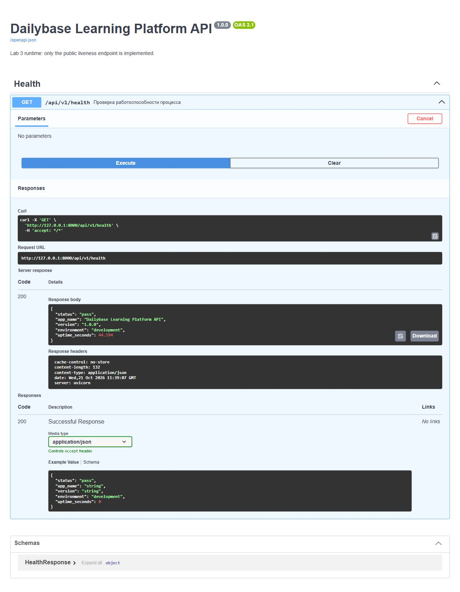

# Лабораторная работа №3

## Цель и результат

Создан запускаемый backend платформы на Python 3.10+ и FastAPI. Реализована слоистая структура, конфигурация из переменных окружения и .env, а также публичная проверка работоспособности `GET /api/v1/health`.

Требования: [Lab 03 Clean Layered Architecture](https://drive.google.com/file/d/1ItS06gGjfcJxSDQE92Z3sed-lO74Onh0/view).

Реально реализован только health-check. Авторизация, CRUD из лабораторной №2, подключение к PostgreSQL и миграции пока остаются запланированными. Health — liveness процесса, а не проверка доступности базы данных.

## Запуск из корня репозитория

PowerShell:

```powershell
python -m venv .venv
.\.venv\Scripts\python.exe -m pip install -r requirements.txt
Copy-Item .env.example .env
.\.venv\Scripts\python.exe -m backend.app
```

Команду копирования выполняйте только при первом запуске, чтобы не перезаписать собственные настройки.

Linux/macOS:

```bash
python3 -m venv .venv
.venv/bin/python -m pip install -r requirements.txt
cp -n .env.example .env
.venv/bin/python -m backend.app
```

Для остановки сервера нажать Ctrl+C. Работа с окружением не требует активации venv: используются прямые пути к интерпретатору.

## Конфигурация

| Переменная | Значение в шаблоне | Назначение |
|---|---|---|
| APP_NAME | Dailybase Learning Platform API | Название сервиса |
| APP_VERSION | 1.0.0 | Версия приложения |
| APP_ENV | development | development, test или production |
| HTTP_HOST | 127.0.0.1 | Адрес привязки сервера |
| HTTP_PORT | 8000 | Порт от 1 до 65535 |

Настройки читаются через Pydantic Settings. Приоритет: аргументы Settings → переменные процесса → корневой .env → значения по умолчанию. Путь .env определяется относительно файла конфигурации, а не текущей рабочей директории.

Неверный порт или неизвестное окружение приводят к ошибке валидации при старте. Локальный .env исключён из Git, а шаблон .env.example не содержит секретов. На этом этапе пароли БД и JWT-ключи не нужны и не создаются.

HTTP_PORT применяется при запуске `python -m backend.app`. Если запускать Uvicorn вручную, его параметры --host/--port задаются отдельно. Название и версия имеют несекретные значения по умолчанию; хардкод реальных секретов отсутствует.

## Структура и зависимости

```text
backend/
  app/
    __main__.py          запуск Uvicorn
    main.py              сборка приложения и жизненный цикл
    config/settings.py   конфигурация окружения
    api/                 HTTP-роутер, DI и Pydantic-схемы
    domain/health.py     модель результата и интерфейс Clock
    services/health.py   сценарий проверки состояния
    infrastructure/      адаптер монотонного времени
    repositories/        место для будущих адаптеров PostgreSQL
tests/                   проверки сервиса, HTTP, конфигурации и контракта
```

HTTP-запрос → роутер → HealthService → Clock. Сервис возвращает обычную dataclass-модель; HTTP-слой преобразует её в JSON через HealthResponse.

Сервис не импортирует FastAPI, Request, Response или настройки окружения. Он зависит от интерфейса Clock, а MonotonicClock подключается снаружи в create_app. Это небольшой работающий пример Dependency Inversion; впоследствии аналогично подключаются репозитории.

Каталог repositories выделен явно, но не содержит фиктивных запросов или подключения к БД. Для liveness чтение из хранилища не требуется.

## Health Check

Проверка PowerShell:

```powershell
Invoke-RestMethod http://127.0.0.1:8000/api/v1/health
```

Проверка curl:

```bash
curl -i http://127.0.0.1:8000/api/v1/health
```

Ожидается 200 OK, Content-Type: application/json и Cache-Control: no-store. Пример тела:

```json
{
  "status": "pass",
  "app_name": "Dailybase Learning Platform API",
  "version": "1.0.0",
  "environment": "development",
  "uptime_seconds": 12.345
}
```

uptime_seconds — секунды после запуска жизненного цикла конкретного экземпляра приложения. Используется monotonic, поэтому перевод системных часов не изменит uptime. После перезапуска значение начинается заново; у нескольких worker-процессов оно отдельное.

Эндпоинт публичный: проверки мониторинга не требуют JWT. Он не раскрывает переменные окружения целиком, секреты или строки подключения.

## Документация API

- `http://127.0.0.1:8000/docs` — Swagger UI реально реализованного health endpoint.
- `http://127.0.0.1:8000/openapi.json` — автоматически созданная FastAPI-схема реализованных маршрутов.
- Корневой openapi.yaml — проектный контракт OpenAPI 3.0.3 всех запланированных операций; к нему добавлен HealthResponse и GET /health.
- docs/swagger.html из лабораторной №2 показывает проектный контракт, включая ещё не реализованные операции.

FastAPI генерирует runtime-документ OpenAPI 3.1.0; проектный YAML сохраняет требуемую лабораторной №2 версию 3.0.3. JSON health-ответа отдельно проверяется на соответствие схеме в YAML.

## Проверки

```powershell
.\.venv\Scripts\python.exe -m pip install -r requirements-dev.txt
.\.venv\Scripts\python.exe -m pytest -q
.\.venv\Scripts\python.exe scripts/validate_openapi.py
git check-ignore .env
git ls-files .env
```

Последняя команда не должна вывести ни одного пути. Проверяются JSON и заголовки health, рост uptime, настройки из .env, приоритет переменных процесса, невалидные настройки, соответствие ответа проектной схеме и отсутствие ложного CRUD. Эти же проверки настроены в GitHub Actions.

## Результаты проверки

- Все 8 автоматических тестов прошли.
- Проектный OpenAPI 3.0.3 валиден: 22 операции, 21 схема.
- Запущен Uvicorn, выполнен настоящий HTTP-запрос: 200 OK, application/json, uptime увеличивается.
- В Swagger UI выполнен Try it out → Execute, получен ответ 200.
- Проверено, что .env исключён из Git и не отслеживается.



## Контрольные вопросы

### Почему сервис не должен знать детали HTTP

Бизнес-сценарий должен работать независимо от транспорта: HTTP, CLI, фоновой задачи или теста. Роутер разбирает запрос и формирует HTTP-ответ, а сервис получает обычные значения и возвращает модель. Это упрощает тестирование и позволяет заменить транспорт без переписывания логики.

### Чем опасны секреты в исходном коде

Секрет попадает в историю Git, копии репозитория, логи и артефакты. Удалить его из последнего файла недостаточно; при утечке нужна ротация. Поэтому значения передаются через окружение или менеджер секретов, а локальный .env не публикуется. Сам .env — обычный текстовый файл, он не обеспечивает шифрование.

### Зачем нужен .env.example

Это безопасный шаблон и документация необходимых переменных. Он позволяет другому разработчику воспроизвести настройку без доступа к чужим секретам. Файл .env содержит локальные значения конкретной среды и исключён из Git.

### Зачем нужен health endpoint

Он позволяет мониторингу, балансировщику или оркестратору проверить, отвечает ли приложение. Наш эндпоинт реализует liveness. Readiness отдельно определяла бы готовность обслуживать рабочие запросы, включая доступность PostgreSQL и других обязательных зависимостей.

### Что такое Dependency Inversion

Высокоуровневая логика зависит от абстракции, а не конкретной инфраструктуры. В нашем коде HealthService зависит от Clock, а точка сборки передаёт MonotonicClock. В тесте можно передать FakeClock. Для работы с данными тот же принцип позволит передавать сервису реализацию интерфейса репозитория.

## Сценарий защиты

1. Показать api, services, domain, infrastructure, repositories и точку сборки main.py.
2. Показать .env.example, settings.py и правило исключения .env.
3. Запустить приложение и открыть /api/v1/health дважды: uptime увеличивается.
4. Открыть /docs и показать реализованный маршрут.
5. Выполнить тесты и объяснить границу между liveness и readiness.
